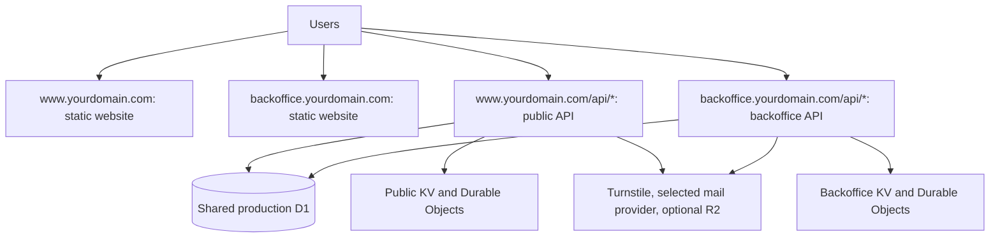

# LoanMS production deployment walkthrough

This guide describes a first deployment of this checkout to Cloudflare. It was
prepared from the repository's actual package scripts, configuration examples,
authentication code, and migrations on October 21, 2026. It does not certify that
the application is ready for production. No infrastructure has been created,
secrets uploaded, migrations applied, or deployments performed by preparing it.

Commands below are for PowerShell, run individually from the repository root.
Replace illustrative domains, account IDs, namespace IDs, and credentials with
your own values. Stop after any failed command and resolve it before continuing.

## 1. Understand what you are deploying

There are four deployable applications. Shared packages are compiled into their
consumers; you do not deploy a separate server for each package.

| Application        | Cloudflare hosting                          | Example production address                |
| ------------------ | ------------------------------------------- | ----------------------------------------- |
| Public website     | Worker Static Assets                        | `https://www.yourdomain.com`              |
| Public API         | Worker, routed under the public website     | `https://www.yourdomain.com/api/*`        |
| Backoffice website | Worker Static Assets                        | `https://backoffice.yourdomain.com`       |
| Backoffice API     | Worker, routed under the backoffice website | `https://backoffice.yourdomain.com/api/*` |

Both APIs use one production D1 database. Each API also has a KV binding and its
own three SQLite Durable Object classes: `RateLimit`, `WebSocketBroker`, and
`WebSocketServer`. Wrangler provisions the Durable Object namespaces from the
existing exports and bindings during deployment.

Additional services are Turnstile for production CAPTCHA, an email provider for
password recovery and verification delivery, and R2 for object storage when
enabled. API keys for service principals are optional. Deploying every
application does not require enabling every optional capability.



This checkout's realtime profiles are `independent-surfaces`; its deployment
examples contain no peer service bindings. Deploy the APIs independently. The
general skill's circular service-binding bootstrap applies only if you later
introduce mutually bound realtime peers.

### Why the API and website must share a hostname

The browser client reads `__Host-csrf_token` from `document.cookie` and sends it
as `X-CSRF-Token`. The API sets that cookie without a `Domain` attribute. A web
page at `www.yourdomain.com` cannot read a cookie set by
`api-public.yourdomain.com`.

For this guide, route `/api/*` to the appropriate API Worker on each website's
hostname. Set both `URL_BACKEND` and `URL_FRONTEND` to that hostname's HTTPS
origin. Set the web build's `PUBLIC_API_URL` to that same origin, **without
`/api`**; the clients already append `/api`.

The API subdomains in `wrangler.toml.example` are illustrative and do not meet
this browser cookie requirement without application changes. Preserve the
host-only cookie policy rather than trying to share its cookie across domains.
Cloudflare supports putting a Worker Route ahead of a Static Assets Worker's
Custom Domain on the same hostname. See [Cloudflare routing](https://developers.cloudflare.com/workers/configuration/routing/routes/).

## 2. Obtain the accounts and tools

Prepare:

1. A domain you control, added as an active DNS zone in your Cloudflare account.
   If you use Cloudflare nameservers, finish the registrar nameserver change and
   wait for zone activation. Preserve existing mail and other DNS records.
2. A Workers Paid subscription. The checked-in APIs configure `cpu_ms = 5000`
   and use scrypt password hashing. The Free plan's documented 10 ms CPU budget
   is unsuitable for assuming this configuration will work unchanged. Paid
   currently starts at USD 5/month before usage and other services; consult
   [pricing](https://developers.cloudflare.com/workers/platform/pricing/) and
   [limits](https://developers.cloudflare.com/workers/platform/limits/).
3. Your Cloudflare Account ID, which is different from the domain's Zone ID.
4. Node.js `26.8.1` or newer and pnpm `12.8.1` or newer, as required by this
   repository. Use the project's installed Wrangler, not an unrelated global
   version. This checkout declares Wrangler `^4.146.0`.
5. A password manager for application secrets and owner credentials.
6. If enabling email: a verified sending domain and an account with the selected
   provider. If enabling storage: R2 enabled on the same Cloudflare account.

Verify tools and install locked dependencies:

```powershell
Set-Location 'D:\Repositories\4thDEVisionTech\loan-ms'
node --version
pnpm --version
pnpm install --frozen-lockfile
pnpm exec wrangler --version
pnpm exec wrangler login
pnpm exec wrangler whoami
```

Login opens a browser authorization flow. Confirm that `whoami` shows the
intended Cloudflare account. When multiple accounts are available, select the
intended account explicitly, for example with `CLOUDFLARE_ACCOUNT_ID` in your
deployment terminal. Do not confuse the Wrangler CLI variable
`CLOUDFLARE_ACCOUNT_ID` with the application's `CF_ACCOUNT_ID` secret.

If pnpm fails because of its version, installation, lockfile, dependency
resolution, or workspace graph, stop and resolve the tooling setup with the
maintainer. Do not regenerate the lockfile just to bypass that failure.

You do not need to rerun the one-time `profile:init` initializer to deploy this
already customized LoanMS checkout.

## 3. Choose a release and rehearse in staging

Use a known source revision and record it:

```powershell
git status --short
git rev-parse HEAD
```

Keep the release revision, operator, date, database identity, selected features,
and deployed Worker version IDs in your release record. Build and deploy the
same source revision to staging and production.

Rehearse this entire process using separate staging resources first. Use these
substitutions throughout the guide:

| Production                                   | Staging equivalent                                    |
| -------------------------------------------- | ----------------------------------------------------- |
| `www.yourdomain.com`                         | `www.staging.yourdomain.com`                          |
| `backoffice.yourdomain.com`                  | `backoffice.staging.yourdomain.com`                   |
| `loanms-production` D1                       | `loanms-staging` D1                                   |
| `wrangler-production.toml`                   | `wrangler-staging.toml`                               |
| `[env.production]` and `--env=production`    | `[env.staging]` and `--env=staging`                   |
| `.env.production` and `.dev.vars.production` | `.env.staging` and `.dev.vars.staging`                |
| `deploy:prod`, `secret:prod`, `migrate:prod` | `deploy:staging`, `secret:staging`, `migrate:staging` |

Use separate staging KV namespaces, storage buckets, and credentials. Configure
real Turnstile keys and `CF_TURNSTILE_BYPASS = 0` in staging to rehearse the actual
production CAPTCHA path; the staging example defaults to bypassing it.

## 4. Create production configuration files

Create these files only if they do not already exist. Do not overwrite an
existing operator's deployment configuration.

```powershell
Copy-Item apps/api-public/wrangler.toml.example apps/api-public/wrangler-production.toml
Copy-Item apps/api-backoffice/wrangler.toml.example apps/api-backoffice/wrangler-production.toml
Copy-Item apps/web-public/wrangler.toml.example apps/web-public/wrangler-production.toml
Copy-Item apps/web-backoffice/wrangler.toml.example apps/web-backoffice/wrangler-production.toml
Copy-Item apps/api-public/.dev.vars.example apps/api-public/.dev.vars.production
Copy-Item apps/api-backoffice/.dev.vars.example apps/api-backoffice/.dev.vars.production
Copy-Item apps/web-public/.env.example apps/web-public/.env.production
Copy-Item apps/web-backoffice/.env.example apps/web-backoffice/.env.production
```

These production files are Git-ignored. Verify that before entering secrets:

```powershell
git check-ignore apps/api-public/.dev.vars.production apps/api-backoffice/.dev.vars.production apps/web-public/.env.production apps/web-backoffice/.env.production apps/api-public/wrangler-production.toml apps/api-backoffice/wrangler-production.toml apps/web-public/wrangler-production.toml apps/web-backoffice/wrangler-production.toml
```

The examples contain both staging and production sections. Edit the selected
production sections, and always select the environment explicitly. A filename
containing `production` does not itself select `[env.production]`.

Keep credentials out of TOML and all `PUBLIC_*` values. Do not copy development
secrets, test Turnstile keys, or zero-filled IDs into production.

## 5. Create the shared D1 database and the KV namespaces

These commands create live Cloudflare resources. Run them only when you intend
to provision this production environment. Dashboard creation is also valid.

```powershell
pnpm exec wrangler d1 create loanms-production
pnpm exec wrangler kv namespace create loanms-public-production
pnpm exec wrangler kv namespace create loanms-backoffice-production
```

Record the returned D1 database UUID and both KV namespace IDs. If prompted to
update a configuration automatically, decline and edit the ignored production
files deliberately. See [D1 commands](https://developers.cloudflare.com/d1/wrangler-commands/)
and [KV commands](https://developers.cloudflare.com/workers/wrangler/commands/kv/).

In the public API's production file, fill the existing blocks:

```toml
[[env.production.d1_databases]]
binding = "LOANMSPUB_D1"
database_name = "loanms-production"
database_id = "REPLACE_WITH_REAL_D1_UUID"
migrations_dir = "../../packages/database/src/d1/migrations/default"
migrations_pattern = "../../packages/database/src/d1/migrations/default/*.sql"

[[env.production.kv_namespaces]]
binding = "LOANMSPUB_KV"
id = "REPLACE_WITH_PUBLIC_KV_ID"
```

In the backoffice API's production file:

```toml
[[env.production.d1_databases]]
binding = "LOANMSBOFC_D1"
database_name = "loanms-production"
database_id = "REPLACE_WITH_THE_SAME_REAL_D1_UUID"

[[env.production.kv_namespaces]]
binding = "LOANMSBOFC_KV"
id = "REPLACE_WITH_BACKOFFICE_KV_ID"
```

Leave the source binding names unchanged. Use a separate KV namespace for each
API here. Both D1 bindings must resolve to the same database. Do not configure
PostgreSQL, Supabase, a `DATABASE_URL`, or Hyperdrive for this deployment.

Preserve the existing three local Durable Object bindings and root `[exports]`
declarations in each API. Do not add `script_name` or legacy migrations to the
local rate limiter. Current declarative exports provision the SQLite namespaces;
see [Durable Object class exports](https://developers.cloudflare.com/durable-objects/reference/durable-objects-migrations/).

## 6. Configure routes and API variables

In `apps/web-public/wrangler-production.toml`, update the existing section:

```toml
[env.production]
name = "loanms-web-public-production"
workers_dev = false
preview_urls = false
route = { custom_domain = true, pattern = "www.yourdomain.com" }
```

For the backoffice web Worker, use name
`loanms-web-backoffice-production` and hostname `backoffice.yourdomain.com`.

Preserve each web file's `[assets]` block: it serves `./dist` and uses the
generated `404.html` fallback. This is Workers Static Assets hosting, rather
than a Cloudflare Pages deployment.

In the public API's production file:

```toml
[env.production]
name = "loanms-api-public-production"
workers_dev = false
preview_urls = false
route = { zone_name = "yourdomain.com", pattern = "www.yourdomain.com/api/*" }
```

For the backoffice API:

```toml
[env.production]
name = "loanms-api-backoffice-production"
workers_dev = false
preview_urls = false
route = { zone_name = "yourdomain.com", pattern = "backoffice.yourdomain.com/api/*" }
```

Edit the existing `[env.production.vars]` values according to this table. Do not
create a duplicate TOML section.

| Variable                    | Public API                     | Backoffice API                        |
| --------------------------- | ------------------------------ | ------------------------------------- |
| `ENVIRONMENT`               | `"production"`                 | `"production"`                        |
| `STATUS` during first setup | `"down"`                       | `"down"`                              |
| `URL_FRONTEND`              | `"https://www.yourdomain.com"` | `"https://backoffice.yourdomain.com"` |
| `URL_BACKEND`               | `"https://www.yourdomain.com"` | `"https://backoffice.yourdomain.com"` |
| `CF_TURNSTILE_BYPASS`       | `0`                            | `0`                                   |
| `FEATURE_MAIL`              | `1` when configured            | `1` when configured                   |
| `FEATURE_OBJECT_STORAGE`    | `1` when configured            | `1` when configured                   |
| `FEATURE_API_KEY`           | Your selected `0` or `1`       | Same selection                        |

Use origins without trailing slashes. Keep the example's credentialed CORS
configuration, `Content-Type`, `X-CAPTCHA-Response`, `X-CSRF-Token`, and
`CORS_ALLOW_METHODS = "GET,POST,QUERY"`. `QUERY` is used by this application.

Preserve the schedules: both APIs recover realtime deliveries every five
minutes; backoffice additionally cleans up audit rows, sessions, verifications,
and API keys. Cron expressions use UTC. The daily audit cleanup at
`0 19 * * *` runs at 03:00 the following day in Manila.

Do not configure a cache-everything rule for `/api/*` or cache authenticated API
responses. Keep DNS and TLS on Cloudflare's edge, and enable HTTPS redirects
without creating a conflicting origin redirect loop.

## 7. Configure production Turnstile

1. In Cloudflare, create a production Turnstile widget, using the widget mode
   appropriate for your account, such as Managed.
2. Allow `www.yourdomain.com` and `backoffice.yourdomain.com` as hostnames.
3. Record the public site key and private secret key. You can use one widget
   for both surfaces or configure separate matching key pairs.
4. Put the site key in each web production environment file.
5. Put the matching secret key in each API production secret file.
6. Keep `CF_TURNSTILE_BYPASS = 0` in the production API variables.

The server verifies the returned hostname against `URL_FRONTEND`, so hostname,
site key, and secret must agree. See [Turnstile hostname management](https://developers.cloudflare.com/turnstile/additional-configuration/hostname-management/).

## 8. Configure application mail

For a deployment with working password recovery and email verification
delivery, configure mail on both APIs. Each independently selects exactly one
provider; the application does not automatically fall back to another provider.

### Option A: Resend

1. Add the exact sender domain/subdomain to Resend and publish its requested
   DNS records. Wait for verification in the provider dashboard.
2. Create a sending API key and store it in the password manager.
3. In each API's existing production variables section, set:

    ```toml
    FEATURE_MAIL = 1
    MAILER_PROVIDER = "resend"
    MAILER_ACCOUNT = "no-reply@mail.yourdomain.com"
    ```

4. Put the real `RESEND_API_KEY` in each `.dev.vars.production` file.
5. Leave the commented Cloudflare `send_email` blocks disabled for this option.

Use the sender actually authorized by your provider, not the illustrative
`loanms.example` sender. Resend onboarding details are in its
[domain documentation](https://resend.com/docs/dashboard/domains/introduction).

### Option B: Cloudflare Email Sending

Onboard and verify the exact sending domain/subdomain in Cloudflare Email
Sending, including its managed SPF, DKIM, DMARC, and bounce records. Arbitrary
application recipients require the paid sending capability, rather than Email
Routing's verified-destination-only mode. See
[sender-domain configuration](https://developers.cloudflare.com/email-service/configuration/subdomains/)
and [Email Service pricing](https://developers.cloudflare.com/email-service/platform/pricing/).

Set `FEATURE_MAIL = 1`, `MAILER_PROVIDER = "cloudflare"`, and the authorized
`MAILER_ACCOUNT` in each API. Uncomment the matching production `send_email`
block with binding `LOANMSPUB_EMAIL` or `LOANMSBOFC_EMAIL` and restrict
`allowed_sender_addresses` to that sender. Named environments need their own
binding declarations. A Resend key is not required for this option.

If you intentionally omit mail, keep `FEATURE_MAIL = 0`. That is a deployable
configuration, but outbound password-reset initiation is unavailable. Do not
present it as a deployment with working email recovery.

## 9. Configure R2 when uploads and downloads are needed

For the complete object-storage capability:

1. In R2, create `loanms-production-prv` and `loanms-production-pub`.
2. Keep public access disabled on the private bucket.
3. Attach a public custom domain such as `files.yourdomain.com` to the public
   bucket and wait for activation. Only deliberately public objects belong
   there; borrower documents requiring privacy belong in private storage.
4. Create R2 S3 API credentials with object read/write access scoped to these
   buckets. These are not your Wrangler login credentials or the public bucket
   URL. Store the access key ID and secret access key securely.
5. In both APIs, set `FEATURE_OBJECT_STORAGE = 1`, the two bucket names,
   `CF_R2_BUCKET_PUBLIC_URL = "https://files.yourdomain.com"`, and
   `CF_R2_PRESIGN_EXPIRY = 300`.
6. Fill `CF_ACCOUNT_ID`, `CF_R2_ACCESS_KEY_ID`, and `CF_R2_SECRET_ACCESS_KEY` in
   both API production secret files.
7. Set `FEATURE_OBJECT_STORAGE="1"` in both web production build files.
8. Configure CORS on both buckets for browser PUT uploads and downloads. For
   these example domains, use:

    ```json
    [
        {
            "AllowedOrigins": [
                "https://www.yourdomain.com",
                "https://backoffice.yourdomain.com"
            ],
            "AllowedMethods": [
                "GET",
                "HEAD",
                "PUT"
            ],
            "AllowedHeaders": ["Content-Type"],
            "ExposeHeaders": ["ETag"],
            "MaxAgeSeconds": 3600
        }
    ]
    ```

The JSON above is the dashboard rule-array form; CLI CORS files may require a
wrapper. Follow the format shown by your chosen configuration interface. If a
browser preflight requests additional headers, permit the actual required
headers deliberately. See [R2 CORS](https://developers.cloudflare.com/r2/buckets/cors/).

This repository signs S3 requests with `aws4fetch`. It does not require a direct
R2 Worker binding, and you should not change that architecture just to deploy.
The web Account ID also allows the account's S3 endpoint in the generated CSP.
Check image/media CSP behavior for the actual files you intend to display.

If omitting object storage, leave the flag at `0` in both APIs and both web
builds. Its routes and UI are intentionally unavailable in that configuration.

## 10. Fill API secrets and web build values

In each API's ignored `.dev.vars.production`, replace all example values:

| Entry                     | Production value                                               |
| ------------------------- | -------------------------------------------------------------- |
| `BETTER_AUTH_SECRET`      | A strong random secret generated for this environment          |
| `CF_DO_RATE_LIMIT_SECRET` | A separate strong random secret for this Worker                |
| `CF_TURNSTILE_SECRET_KEY` | The production widget's secret                                 |
| `CF_ACCOUNT_ID`           | Actual Cloudflare Account ID, required when storage is enabled |
| `CF_R2_ACCESS_KEY_ID`     | Scoped R2 access key, required when storage is enabled         |
| `CF_R2_SECRET_ACCESS_KEY` | R2 secret key, required when storage is enabled                |
| `RESEND_API_KEY`          | Required only for enabled Resend delivery                      |

Generate at least 32 random bytes per application secret using a trusted local
password manager or cryptographic generator. Store stable values securely;
changing auth secrets later can invalidate authentication state. Independent
API limiter namespaces can use different limiter secrets.

Remove unused example credentials instead of uploading placeholders. Google
OAuth entries are reserved and currently unwired; supplying their values does
not enable Google sign-in. There is no Stripe or other payment gateway secret
declared in these API secret examples; the loan payment workflow itself is not
evidence of an external card-payment integration.

Set `apps/web-public/.env.production` to:

```dotenv
FEATURE_IN_APP_BROWSER_DETECTION="0"
FEATURE_OBJECT_STORAGE="1"
PUBLIC_NAME="LoanMS"
PUBLIC_API_URL="https://www.yourdomain.com"
PUBLIC_CF_ACCOUNT_ID="REPLACE_WITH_REAL_32_CHARACTER_ACCOUNT_ID"
PUBLIC_CF_TURNSTILE_SITE_KEY="REPLACE_WITH_PRODUCTION_SITE_KEY"
```

Set `apps/web-backoffice/.env.production` to:

```dotenv
FEATURE_API_KEY="0"
FEATURE_IN_APP_BROWSER_DETECTION="0"
FEATURE_OBJECT_STORAGE="1"
PUBLIC_NAME="LoanMS"
PUBLIC_API_URL="https://backoffice.yourdomain.com"
PUBLIC_CF_ACCOUNT_ID="REPLACE_WITH_REAL_32_CHARACTER_ACCOUNT_ID"
PUBLIC_CF_TURNSTILE_SITE_KEY="REPLACE_WITH_PRODUCTION_SITE_KEY"
```

These examples select enabled storage and disabled service principals; adjust
the flags consistently to your decisions. To include service-principal API
keys, use `FEATURE_API_KEY = 1` in both APIs and `FEATURE_API_KEY="1"` in the
backoffice build. In-app browser detection is an independent UI choice.

Web values are compiled into the static build, not read from live Worker
secrets. Rebuild and redeploy after changing them. Both deployment scripts use
`vite build --mode=production`; if building manually, retain the `--mode=production`
form because the Svelte configuration also reads that command-line mode.

Review `.env.local` and `.env.production.local` and any shell/CI variables for
overrides before building. Explicit environment variables can override file
values. A successful build with a stale localhost URL will still be unusable.

## 11. Validate locally before publishing

Build shared dependencies before checking consuming applications:

```powershell
pnpm --filter='./packages/**' --if-present build
pnpm --filter=@loanms/database check
pnpm --filter=@loanms/api-public check
pnpm --filter=@loanms/api-backoffice check
pnpm --filter=@loanms/web-public check
pnpm --filter=@loanms/web-backoffice check
pnpm lint
```

Inspect production API bundles without publishing:

```powershell
pnpm --filter=@loanms/api-public exec wrangler deploy --dry-run --env=production --config=wrangler-production.toml
pnpm --filter=@loanms/api-backoffice exec wrangler deploy --dry-run --env=production --config=wrangler-production.toml
```

Build the production web artifacts without publishing:

```powershell
pnpm --filter=@loanms/web-public exec vite build --mode=production
pnpm --filter=@loanms/web-backoffice exec vite build --mode=production
```

Inspect `apps/web-public/dist` and `apps/web-backoffice/dist`, including
`404.html` and `_headers`. Resolve errors before deployment. Dry runs do not
prove that remote credentials, resource permissions, mail, or routes work.

Run affected tests for any release changes using their owning package phase
scripts. Examples of focused migration and payment verification are:

```powershell
pnpm --filter=@loanms/api-public test:seq test/integration/d1Migrations.seq.test.ts
pnpm --filter=@loanms/api-backoffice test:seq test/api/payments.seq.test.ts
```

Choose additional affected suites according to the release diff. Do not use
aggregate `test`. If an agent executes Vitest or Playwright in this repository,
it must start the command with tool-level elevated permissions, per `AGENTS.md`.
This guide itself has not run these application checks or tests.

## 12. Restrict first-deployment access

The default schema migration seeds an organization and **three enabled users
with a documented shared default password**. This is a concrete first-launch
issue, not just an example secret in a config file.

Before an API becomes available, temporarily restrict both website hostnames
to the deployment operator. One approach is a Cloudflare WAF custom Block rule
scoped to these two hosts and traffic outside an operator IP allowlist. Include
the public IPv4/IPv6 addresses actually used by your browser. Verify the rule
from an allowed network and an unallowed network before proceeding. See
[Cloudflare's IP allowlist pattern](https://developers.cloudflare.com/waf/custom-rules/use-cases/allow-traffic-from-ips-in-allowlist/).

A correctly configured Cloudflare Access policy is another option. Apply it to
the website and all its `/api/*` and WebSocket traffic together. Do not expose
an alternate `workers.dev` or preview hostname that bypasses the restriction.
The deployment configs should keep both of those disabled.

Keep the restriction active until all seeded accounts are secured and the
browser workflows below pass. `STATUS="down"` prevents normal HTTP access but
does not replace an access restriction during the interactive bootstrap, and
it does not disable the scheduled handler.

## 13. Initialize the production database

For a **new, empty database**, apply the default history once through the
public API configuration:

```powershell
pnpm --filter=@loanms/database migrate:prod
```

Read Wrangler's target database and migration confirmation before accepting.
This script explicitly uses the production environment and remote D1. Never
apply the test-only seed directory to production, and never run the shared
migrations again through the backoffice workspace.

Check the resulting history and foreign keys:

```powershell
pnpm exec wrangler d1 migrations list loanms-production --remote --env=production --config=apps/api-public/wrangler-production.toml
pnpm exec wrangler d1 execute loanms-production --remote --env=production --config=apps/api-public/wrangler-production.toml --command='PRAGMA foreign_key_check;'
```

The foreign-key check should return no violating rows. Confirm the database
contains the loan-domain tables as well as authentication tables.

This consolidated baseline is for fresh databases. If production already has a
database, stop here: confirm its exact history, back it up, and prepare a
reviewed upgrade migration. Reapplying a rewritten baseline is not an upgrade
strategy. Local `.wrangler/state` data is not automatically copied to remote
D1; existing-data transfer is a separate reviewed task.

## 14. Deploy websites first, then bootstrap API Workers and secrets

Deploying the two web Custom Domains first establishes their DNS and TLS
origins before adding the API routes. The sites may show API errors until the
APIs are enabled; keep them restricted during this window.

```powershell
pnpm --filter=@loanms/web-public deploy:prod
pnpm --filter=@loanms/web-backoffice deploy:prod
```

Verify both Custom Domains are active and resolve through Cloudflare. A Worker
Route needs a proxied DNS record for its hostname; the website Custom Domains
provide that in this topology. If an existing conflicting DNS record prevents
Custom Domain creation, inspect and reconcile it deliberately rather than
deleting records blindly.

With each API's production `STATUS` still set to `"down"`, deploy the APIs to
create their Workers and Durable Object namespaces:

```powershell
pnpm --filter=@loanms/api-public deploy:prod
pnpm --filter=@loanms/api-backoffice deploy:prod
```

Upload each API's prepared secrets using its existing script:

```powershell
pnpm --filter=@loanms/api-public secret:prod
pnpm --filter=@loanms/api-backoffice secret:prod
```

Creating the Workers first avoids depending on secret-upload behavior for a
Worker that does not yet exist. Keeping `STATUS="down"` avoids serving the
application before secrets are provisioned. Feature startup validation permits
this maintenance state. Secret commands are live changes and can deploy a new
version; handle them as a release operation, as described in
[Cloudflare secrets](https://developers.cloudflare.com/workers/configuration/secrets/).

Now change `STATUS` to `"up"` in both API production variable sections and
redeploy, while retaining the operator-only edge restriction:

```powershell
pnpm --filter=@loanms/api-public deploy:prod
pnpm --filter=@loanms/api-backoffice deploy:prod
```

If startup fails, inspect Worker logs and correct missing variables/bindings.
Do not disable required production protections to make a deployment pass.

## 15. Secure accounts and configure the lending business

The seeded organization slug is `superorganization`. The seeded usernames are
`superadministrator` (owner), `administrator` (admin), and `member` (member).
The bootstrap password is documented in the default schema migration near
its account seed; use it only inside the restricted bootstrap window.

1. Open the restricted backoffice site and sign in using the owner and seeded
   organization slug.
2. Change the owner's password immediately through the application. Save the
   new unique password in the password manager, sign out, and verify it works.
3. Change the passwords of both remaining seeded users to independent random
   values, or disable unused accounts through the supported staff-management
   controls. Verify every seeded account is covered; do not assume a password
   change for the owner changes the other two accounts.
4. Replace placeholder profile/email details through supported application
   controls before relying on mail recovery. Verify that the owner can receive
   recovery email. Keep the organization slug recorded if retaining it.
5. Confirm the old shared password no longer permits any seeded user to sign
   in on either surface. Check that obsolete sessions are invalidated.
6. Configure the organization-specific loan products/formula profiles, payment
   frequencies, renewal rules, borrower-tag policy, staff roles, company fund,
   and opening capital needed for real operations. The default baseline does
   not seed a ready-to-use production formula catalog.
7. Use approved opening balances and records. Do not populate production with
   test borrowers, invented capital, or test payments to make dashboards look
   complete. Perform destructive or repeatable financial smoke scenarios in
   staging instead.

If any seeded account cannot be secured through the available application
controls, keep access restricted and prepare an explicit bootstrap operation
with the maintainer. Do not edit an already applied baseline or write plaintext
passwords into D1. This repository uses a custom scrypt password format.

## 16. Verify the complete deployment

From the allowed operator network, check both API heartbeats:

```powershell
curl.exe -i https://www.yourdomain.com/api/heartbeat
curl.exe -i https://backoffice.yourdomain.com/api/heartbeat
```

Expect `204 No Content`. This tests routing and the top-level availability gate;
it does not prove the database or full authentication flow works.

Verify the following in the browser before opening access:

| Area                | What to verify                                                                                                                   |
| ------------------- | -------------------------------------------------------------------------------------------------------------------------------- |
| Routing             | `/api/*` returns API responses; page requests return the correct website                                                         |
| SPA navigation      | Open a nested application URL directly and refresh it; the Svelte app renders through the existing `404.html` fallback           |
| Build environment   | Network requests use the production same-host origin, with no localhost or `.example` requests                                   |
| CAPTCHA             | Real Turnstile works on both configured hostnames; missing/invalid challenges are rejected                                       |
| Authentication      | Sign-in, organization selection, refresh, sign-out, and expired-session handling work                                            |
| CSRF                | A safe request sets `__Host-csrf_token`; mutations send its matching header; invalid/missing tokens are rejected                 |
| Authorization       | Owner, admin, cashier, collector, viewer, and auditor access matches the roles actually assigned                                 |
| Persistence         | An approved change survives a page reload and is visible through the owning API                                                  |
| Lending             | Staging loan creation, installment schedules, payments, allocations, collections, renewals, and reports reconcile                |
| Audit history       | Successful administrative/business mutations appear with the correct actor and organization                                      |
| Email               | Password-reset delivery reaches an external recipient; the link uses the correct website; redemption succeeds                    |
| Storage             | When enabled, upload/commit/download works; public and private access behave as intended; direct private-object access is denied |
| Realtime            | WebSockets connect through the expected `/api/ws` route; reconnect and session revocation behave correctly                       |
| Optional API keys   | When enabled, service principals obey tenant and permission restrictions; unused capability stays disabled                       |
| Network protections | `workers.dev` and preview URLs cannot bypass your chosen edge restrictions                                                       |
| Scheduled work      | Both recovery schedules and backoffice retention schedules exist and run without errors                                          |

The static adapter intentionally uses a `404.html` fallback. Deep links can
render successfully while retaining an HTTP 404 status; test browser behavior
and account for that in monitoring. A change to 200-status SPA handling is a
separate configuration decision, not part of these deployment steps.

Inspect live API logs while testing:

```powershell
pnpm --filter=@loanms/api-public exec wrangler tail --env=production --config=wrangler-production.toml
pnpm --filter=@loanms/api-backoffice exec wrangler tail --env=production --config=wrangler-production.toml
```

Each tail command runs until stopped; use separate terminals and Ctrl+C when
finished. Avoid logging passwords, tokens, raw sensitive borrower data, or
secret file contents.

## 17. Open access and establish operations

After all bootstrap and verification steps pass, deliberately remove the
temporary restriction from the public hostname. Set the backoffice's intended
staff-access policy; public reachability does not grant anonymous application
authorization, and a private staff edge policy may still be appropriate.

Retest from a second network, then record:

- The source revision and the deployed version of each of the four Workers.
- The production database UUID, migration history, KV namespaces, bucket names,
  configured hostnames, and enabled capabilities.
- The location of credentials in the password manager and who can rotate them.
- Monitoring for API failures, authentication failures, mail delivery errors,
  scheduled-job failures, D1 capacity, R2 usage, and Cloudflare billing.
- A tested backup/restore procedure. D1 Time Travel is available, but its
  retention depends on the plan; verify your actual window and practice a
  restore in an isolated environment. See [D1 recovery](https://developers.cloudflare.com/d1/reference/time-travel/).
- Separate protection/recovery for R2 objects. Restoring D1 does not restore
  deleted R2 objects or roll back Durable Object state.

The web apps already ship `_headers` files. Verify the actual edge headers and
generated CSP before adding global transforms. The repository's
`scripts/cloudflare/configure-security-headers.mjs` is an optional tool, not a
required deployment command. Its apply mode can disable a zone-wide managed
security-header transform, so do not run it casually on a zone hosting other
sites.

## 18. Deploy future releases and recover from a bad release

For later releases, repeat local validation and staging verification first.
Review migrations separately from code rollout. Back up and review any
production data change before running `migrate:prod`.

For a compatible release, the normal deployment order is:

```powershell
pnpm --filter=@loanms/database migrate:prod
pnpm --filter=@loanms/api-public deploy:prod
pnpm --filter=@loanms/api-backoffice deploy:prod
pnpm --filter=@loanms/web-public deploy:prod
pnpm --filter=@loanms/web-backoffice deploy:prod
```

Run the migration command only when the release actually contains reviewed
pending migrations. Breaking schema changes need a coordinated maintenance
window or a compatible multi-stage rollout; the sequence above does not make
arbitrary schema changes safe.

If a release fails, restrict access or enter maintenance as appropriate, inspect
logs, and redeploy a known compatible revision of the affected Workers.
Worker rollback does not undo D1 migrations, R2 changes, or Durable Object
state. Do not restore a financial database blindly after users have submitted
new transactions; determine the reconciliation and recovery procedure first.

The existing GitLab/Supabase files are provider templates and do not establish
a working production pipeline for these four Workers. After the manual process
works, configure CI deliberately with protected credentials and an environment
approval/manual deployment gate. Do not assume pushing a commit deploys this
project automatically.

## Troubleshooting

| Symptom                            | Likely cause and next step                                                                                   |
| ---------------------------------- | ------------------------------------------------------------------------------------------------------------ |
| Site requests localhost            | Wrong web build variables or higher-priority environment override; rebuild in production mode                |
| API returns HTML                   | `/api/*` route is absent, conflicts, or targets the wrong Worker                                             |
| DNS failure or TLS pending         | Zone, Custom Domain, conflicting DNS, or certificate activation is incomplete                                |
| All API calls return 503           | `STATUS` remains down, or required runtime configuration/startup validation fails                            |
| Sign-in POST fails CSRF            | API is on a different hostname, initial safe request did not set the cookie, or frontend/API modes disagree  |
| Origin/CORS errors                 | `URL_FRONTEND` differs from the browser's exact origin; check scheme, hostname, and trailing slash           |
| Turnstile fails                    | Test keys, mismatched key pair, widget hostname allowlist, or server expected hostname differs               |
| Storage routes return 404          | One or more object-storage feature flags are disabled                                                        |
| Upload preflight fails             | R2 bucket CORS does not allow the actual browser origin/method/headers                                       |
| Mail-reset initiation returns 404  | `FEATURE_MAIL` is disabled on that API                                                                       |
| Mail startup/delivery fails        | Wrong provider, unverified sender, missing Resend secret, or missing Cloudflare production binding           |
| No such table/column               | Wrong shared D1 binding, unapplied migration, or use of a fresh baseline against an existing database        |
| Financial screens are empty        | Business configuration/opening data has not been initialized; deployment does not create operational records |
| Realtime never connects            | API path routing, origin checks, WebSocket edge settings, or Durable Object bindings are wrong               |
| Production works only for operator | Temporary WAF/Access bootstrap restriction remains active                                                    |

## Scope of this guide

Only `PRODUCTION_DEPLOYMENT.md` was added while preparing these instructions.
Application/configuration files and live services were not changed. The guide
was checked against local source and official provider documentation; its
commands are operator instructions, not a record of successful execution. A
production-readiness review and live end-to-end verification remain necessary
before admitting real users and financial data.
